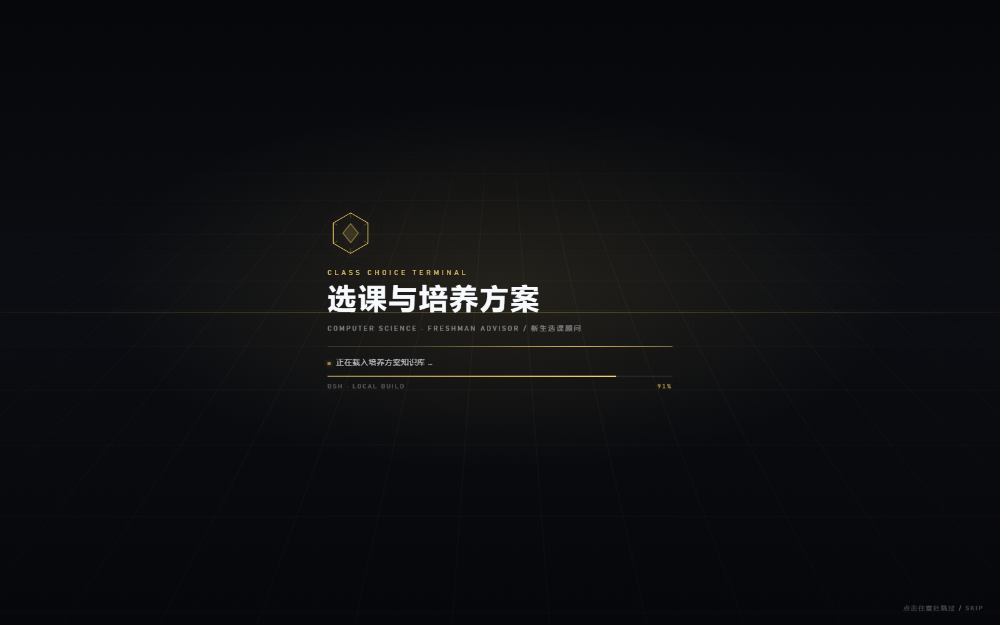
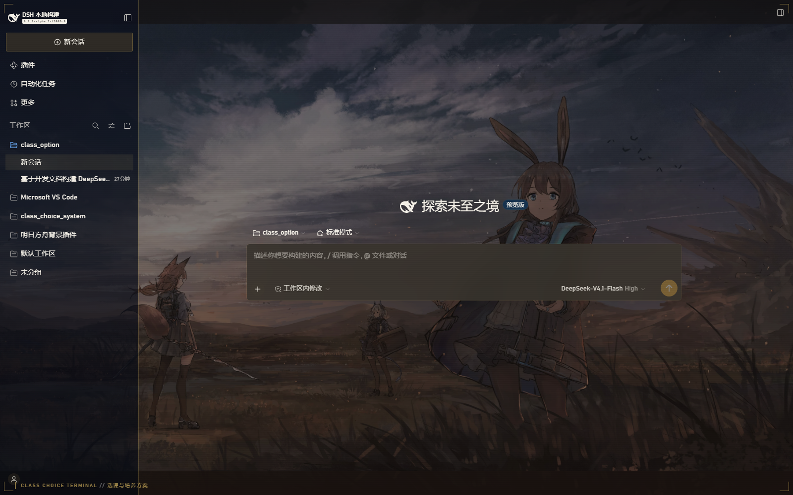

# 选课与培养方案终端 · Class Choice Terminal

面向计算机类新生的选课与培养方案问答终端，交付形态是 [DeepSeek Harness](https://github.com/deepseek-ai/deepseek-harness)（DSH）插件套件：一套**明日方舟风格**的 Web 界面与开场动画，加一套**课程 / 教师 / 培养方案 / 学分 / 规则**查询工具。

界面不是另起一套前端，而是通过 DSH 的 `webserver/index-inject` 注入行实现，因此保留 DSH 的会话、工具调用、Skill 与权限体系，插件随装随用。

## 界面预览

开场动画（启动时约 2.6 秒，可点击任意处跳过）：



进入工作区后的主界面：



## 组成

| 目录 | 作用 |
| --- | --- |
| `plugins/dsh-arknights-theme/` | 明日方舟风格皮肤 + 开场动画 + HUD 边角框，纯注入式，无客户端 bundle |
| `plugins/dsh-class-choice/` | 5 个选课域工具（课程 / 培养方案 / 学分核算 / 教师 / 规则条款）与示例数据 |
| `profile/` | 本地 Web profile 的 overlay 示例（`--patch` 用） |
| `scripts/` | 从源码构建 DSH 并启动带插件的 Web UI |
| `.dsh/skills/` | 可选的项目级 Skill：选课顾问的问答流程 |
| `docs/` | 前期需求与方案文档（.docx） |

## 快速开始

前置：Node.js ≥ 24.9、pnpm、git，以及一个可写的 DSH 配置目录（默认 `~/.dsh`）。

```powershell
# 1. 构建 Harness 源码（只在专用的构建目录里进行）
pwsh ./scripts/setup-dev.ps1

# 2. 启动带插件的 Web UI
pwsh ./scripts/dev-web.ps1 -Port 3080
```

`setup-dev.ps1` 会：克隆 `deepseek-harness` 到同级目录 `../class_choice_system_contribute/deepseek-harness`（已存在则复用）→ 执行 `pnpm install` → 执行 `pnpm run build:artifacts` → 生成本机可用的 `profile/class-choice.overlay.yml`（绝对路径）→ 打印启动命令。

首次启动后终端会打印形如 `dsh web: http://127.0.0.1:3080/?token=...` 的地址，用浏览器打开即可。带 `token` 的链接用于建立本地信任，换端口或重启后以新打印的地址为准。

如果已经有一份构建好的 DSH，只想装插件：

```powershell
# 在 deepseek-harness 目录中
pnpm dsh --profile web --patch <本仓库>/profile/class-choice.overlay.yml --no-open --port 3080
```

> overlay 中的插件路径必须是绝对路径，这是 DSH loader 的约定。

## 插件一：明日方舟风格界面（dsh-arknights-theme）

- **调色板**：暖石墨底 + 琥珀金强调色，覆盖 DSH 的 `--dsw-alias-*` 语义 token；半透明表面让底图（如果 profile 里有背景插件）透出。
- **开场动画**：六边形徽标描边 → 标题遮罩展开 → 终端自检日志与进度条 → 上收式揭幕。点击 / 按键可跳过；`prefers-reduced-motion` 下自动退化为静默淡出；4.6 秒故障保护，即使脚本报错也不会锁死界面。
- **常驻 HUD**：四角细金边、左下角 `CLASS CHOICE TERMINAL // 选课与培养方案` 状态条、极轻扫描线。
- **无构建产物**：插件在 `apply()` 时读取本地 `theme.css` / `splash.css` / `splash.html` / `splash.js`，通过 `webserver/index-inject` 推送 `style` / `html` / `script` 行，因此不需要打包客户端 bundle，也不依赖 React。

实现约束（改样式前请先读）：

1. 注入文本里**不能出现** `<body`、`<head`、`<html` 字面量。DSH 在组装 index 时按这些标记定位插入点，样式注释里写一个 `<body>` 就会让插入点落到注释里，整页解析错位。插件加载时会自检并给出明确报错。
2. 覆写 token 使用 `html:root body ... !important`。运行时主题表在插件之后注入，社区背景插件也会用 `!important` 覆写同一批变量，只有更高的选择器权重才能稳定生效。
3. 开场动画的样式必须放在独立的 `style` 行里，不能内嵌在注入的 HTML 片段中——解析器会重定位片段内的 `<style>`，把覆盖层拆散。

## 插件二：选课域工具（dsh-class-choice）

| 工具 | 用途 |
| --- | --- |
| `cc_course_lookup` | 按课程名 / 代码 / 简称查学分、学时、性质、建议学期、模块、先修课 |
| `cc_plan_overview` | 培养方案总学分与模块最低学分结构 |
| `cc_credit_audit` | 按已修课程代码逐模块核算已修 / 要求 / 差额 |
| `cc_teacher_lookup` | 教师公开档案、授课记录、考核方式；显式拒绝主观评价 |
| `cc_policy_search` | 选课与学籍管理规定条款检索，带条款编号与出处 |

设计取舍与前期方案一致：**事实来自数据，模型只负责组织语言**；查不到时工具返回明确的“未找到”话术，而不是让模型推测。

工具以普通 `ToolDefinition` 字面量注册（未引入 `defineTool` 依赖），因此整个插件零运行时依赖，按路径即可加载。

### 数据

`plugins/dsh-class-choice/data/*.json` 是**演示数据**（12 门课程、8 位教师、7 个模块、6 条规则），用于联调与演示。正式部署时替换为教务处的培养方案与课程库，保持字段不变即可；所有工具输出都会带上数据版本号。

### Skill（可选）

`.dsh/skills/class-choice-advisor/SKILL.md` 描述了“先查事实 → 再解释规则 → 必须带来源 → 查不到转人工”的问答流程。

- 项目级生效：在本仓库（含 `.git` 的目录）中启动会话即可被发现。
- 全局生效：把该目录复制到 `~/.dsh/skills/`。

## 目录结构

```text
class_choice_system/
├── README.md
├── plugins/
│   ├── dsh-arknights-theme/
│   │   ├── package.json
│   │   └── src/{index.ts,theme.css,splash.css,splash.html,splash.js}
│   └── dsh-class-choice/
│       ├── package.json
│       ├── src/index.ts
│       └── data/{courses,teachers,plan,policies}.json
├── profile/
│   └── class-choice.overlay.yml        # setup-dev.ps1 生成，含本机绝对路径
├── scripts/{setup-dev.ps1,dev-web.ps1}
├── .dsh/skills/class-choice-advisor/SKILL.md
├── docs/                               # 前期需求与方案文档
└── screenshots/
```

## 开发与验证

- 构建产物与 `node_modules` 全部位于 `../class_choice_system_contribute/deepseek-harness`，本仓库只保存可上传的源码、文档与截图。
- 主题插件的资源在 `apply()` 时读取一次；改完 CSS/HTML/JS 后重启 `dev-web.ps1` 即可看到效果。
- 工具逻辑可脱离模型单测：`node --import tsx .scratch/plugin-smoke.mjs`（脚本示例见下），或直接在会话里让模型调用工具。

```js
import { apply } from './plugins/dsh-class-choice/src/index.ts'
const registered = []
apply({ tools: { register: (definition) => registered.push(definition) } })
const result = await registered[0].execute({ query: '程设' }, {})
```

## 已知限制与下一步

- 演示数据只覆盖一个专业、一个年级；多专业 / 多版本需要按“专业 + 年级 + 生效学年”三元组扩展数据层（方案文档 4.5 节）。
- 课程卡片、来源卡片、学分进度视图目前以 Markdown 表格呈现；要做到真正的结构化卡片，需要新增带 `dsh.client` 的客户端插件，而不是继续用注入行。
- 时间冲突判断、课表比对尚未实现（缺少开课记录与课表数据）。
- 尚未接入真实教务系统与身份授权，学分核算以手工输入为准。

## 许可

MIT。界面与动画为原创实现，仅借鉴明日方舟的视觉语言（深色工业感、琥珀金强调、切角与细描边），不包含其素材或商标。
